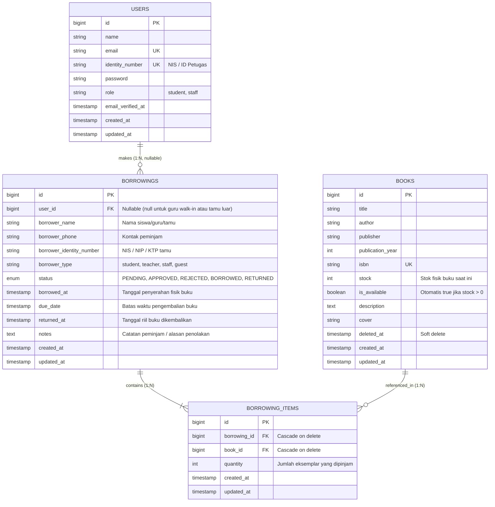
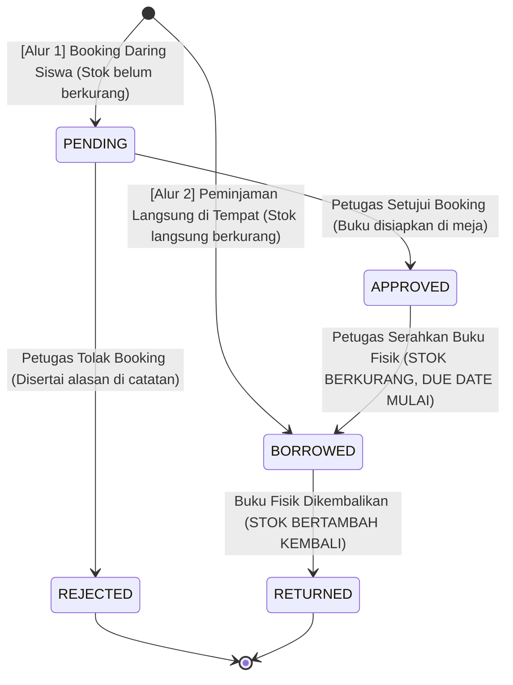
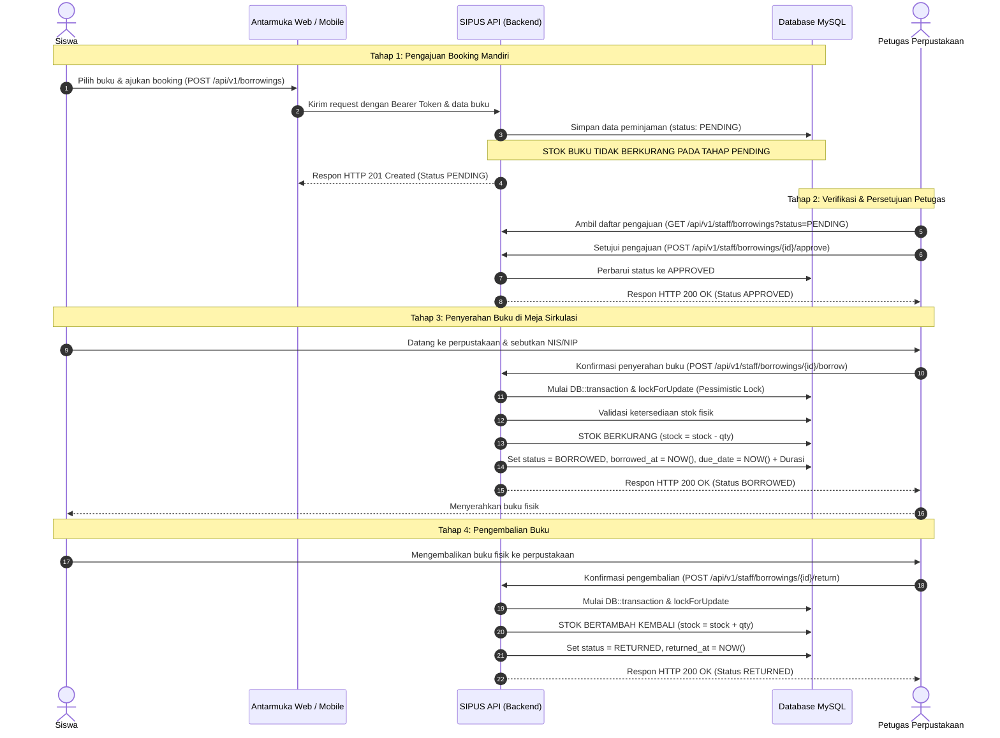
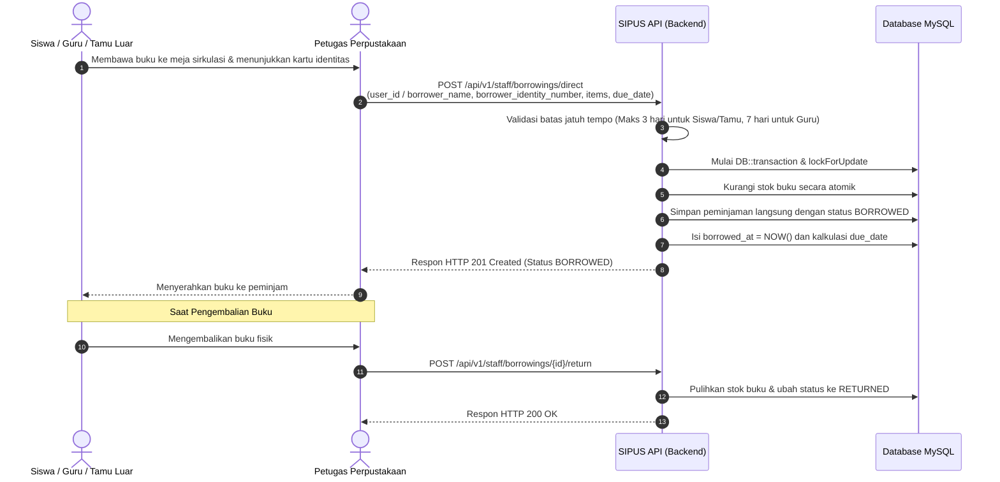

# RANCANGAN SISTEM DAN BASIS DATA (SIPUS API)
## Sistem Informasi Perpustakaan Sekolah — Backend RESTful API

Dokumen ini disusun sebagai lampiran dan referensi bab analisis serta perancangan sistem (*System Design & Architecture*) pada laporan Capstone Project.

---

## 1. Rancangan Basis Data (Database Design)

### 1.1. Entity Relationship Diagram (ERD)

Berikut adalah relasi antar-entitas data dalam sistem SIPUS API:



---

### 1.2. Kamus Data & Struktur Tabel Fisik

#### A. Tabel: `users`
Menyimpan data identitas akun anggota terdaftar perpustakaan (Siswa dan Petugas).

| Nama Kolom | Tipe Data | Constraint | Keterangan |
|---|---|---|---|
| `id` | `BIGINT UNSIGNED` | Primary Key, Auto Increment | Identifikasi unik pengguna |
| `name` | `VARCHAR(255)` | Not Null | Nama lengkap pengguna |
| `email` | `VARCHAR(255)` | Not Null, Unique | Alamat surel aktif untuk autentikasi login |
| `identity_number` | `VARCHAR(255)` | Nullable, Unique | **NIS/NISN** (Siswa), **ID** (Staff) |
| `password` | `VARCHAR(255)` | Not Null | Kata sandi terenkripsi (*hashed*) |
| `role` | `VARCHAR(255)` | Not Null, Default: `'student'` | Peran pengguna (`student`, `staff`). Guru dilayani via walk-in |
| `email_verified_at`| `TIMESTAMP` | Nullable | Waktu verifikasi surel |
| `remember_token` | `VARCHAR(100)` | Nullable | Token sesi autentikasi |
| `created_at` | `TIMESTAMP` | Nullable | Waktu pembuatan data |
| `updated_at` | `TIMESTAMP` | Nullable | Waktu pembaruan data terakhir |

---

#### B. Tabel: `books`
Menyimpan katalog bahan pustaka dan ketersediaan stok fisik eksemplar buku.

| Nama Kolom | Tipe Data | Constraint | Keterangan |
|---|---|---|---|
| `id` | `BIGINT UNSIGNED` | Primary Key, Auto Increment | Identifikasi unik buku |
| `title` | `VARCHAR(255)` | Not Null | Judul buku |
| `author` | `VARCHAR(255)` | Not Null | Pengarang / Penulis buku |
| `publisher` | `VARCHAR(255)` | Not Null | Nama penerbit |
| `publication_year`| `INTEGER` | Not Null | Tahun publikasi / cetak |
| `isbn` | `VARCHAR(50)` | Not Null, Unique | International Standard Book Number |
| `stock` | `INTEGER` | Not Null, Default: `0` | Jumlah stok fisik yang tersedia untuk dipinjam |
| `is_available` | `BOOLEAN` | Not Null, Default: `true` | Indikator ketersediaan buku |
| `description` | `TEXT` | Nullable | Sinopsis atau deskripsi isi buku |
| `cover` | `VARCHAR(255)` | Nullable | URL gambar sampul (*cover*) buku |
| `deleted_at` | `TIMESTAMP` | Nullable | Penanda *Soft Delete* (menyembunyikan buku dari katalog aktif tanpa menghapus data fisik) |
| `created_at` | `TIMESTAMP` | Nullable | Waktu pembuatan data |
| `updated_at` | `TIMESTAMP` | Nullable | Waktu pembaruan data terakhir |

---

#### C. Tabel: `borrowings`
Menyimpan *header* transaksi sirkulasi peminjaman (baik daring maupun peminjaman langsung di tempat).

| Nama Kolom | Tipe Data | Constraint | Keterangan |
|---|---|---|---|
| `id` | `BIGINT UNSIGNED` | Primary Key, Auto Increment | Identifikasi unik transaksi peminjaman |
| `user_id` | `BIGINT UNSIGNED` | Nullable, FK ke `users.id` | Akun anggota terdaftar. Bernilai `NULL` jika peminjam tidak memiliki akun login (seperti guru yang meminjam walk-in atau tamu luar) |
| `borrower_name` | `VARCHAR(255)` | Nullable | Nama peminjam (wajib jika `user_id` bernilai `NULL`) |
| `borrower_phone` | `VARCHAR(50)` | Nullable | Nomor telepon / WhatsApp peminjam |
| `borrower_identity_number` | `VARCHAR(50)` | Nullable | Nomor identitas peminjam (NIS / NIP / KTP tamu) |
| `borrower_type` | `VARCHAR(30)` | Not Null, Default: `'student'` | Nilai: `'student'`, `'teacher'`, `'staff'`, `'guest'` (Staff didukung untuk tenaga kependidikan) |
| `status` | `ENUM` | Not Null, Default: `'PENDING'` | Nilai: `'PENDING'`, `'APPROVED'`, `'REJECTED'`, `'BORROWED'`, `'RETURNED'` |
| `borrowed_at` | `TIMESTAMP` | Nullable | Waktu buku fisik diserahkan kepada peminjam |
| `due_date` | `TIMESTAMP` | Nullable | Batas akhir pengembalian (maks 3 hari untuk siswa/tamu, 7 hari untuk guru/staff) |
| `returned_at` | `TIMESTAMP` | Nullable | Waktu riil buku dikembalikan ke perpustakaan |
| `notes` | `TEXT` | Nullable | Catatan keperluan pinjam atau alasan penolakan petugas |
| `created_at` | `TIMESTAMP` | Nullable | Waktu pembuatan data |
| `updated_at` | `TIMESTAMP` | Nullable | Waktu pembaruan data terakhir |

---

#### D. Tabel: `borrowing_items`
Menyimpan rincian item buku yang dipinjam dalam satu nomor transaksi (*one-to-many relationship*).

| Nama Kolom | Tipe Data | Constraint | Keterangan |
|---|---|---|---|
| `id` | `BIGINT UNSIGNED` | Primary Key, Auto Increment | Identifikasi unik baris item peminjaman |
| `borrowing_id`| `BIGINT UNSIGNED` | Not Null, FK ke `borrowings.id` (ON DELETE CASCADE) | Relasi ke transaksi peminjaman utama |
| `book_id` | `BIGINT UNSIGNED` | Not Null, FK ke `books.id` (ON DELETE CASCADE) | Relasi ke buku yang dipinjam |
| `quantity` | `INTEGER` | Not Null, Default: `1` | Jumlah eksemplar buku yang dipinjam |
| `created_at` | `TIMESTAMP` | Nullable | Waktu pembuatan data |
| `updated_at` | `TIMESTAMP` | Nullable | Waktu pembaruan data terakhir |

---

## 2. Alur Sistem & Siklus Transaksi (System Workflows)

### 2.1. State Machine Status Peminjaman

Sistem mengontrol siklus hidup (*lifecycle*) peminjaman melalui pembatasan transisi status yang ketat:



---

### 2.2. Sequence Diagram Alur 1: Peminjaman Daring Siswa (Online Booking)

Alur ini digunakan oleh siswa yang ingin memesan buku terlebih dahulu melalui sistem sebelum mengambilnya secara fisik di perpustakaan.



---

### 2.3. Sequence Diagram Alur 2: Peminjaman Langsung di Tempat (*Walk-in Service*)

Alur ini digunakan apabila siswa, guru, atau tamu/orang tua siswa datang langsung ke meja sirkulasi membawa buku fisik tanpa reservasi aplikasi sebelumnya.



---

## 3. Logika Bisnis Khusus (Business Rules)

### 3.1. Kebijakan Sirkulasi & Diferensiasi Durasi Batas Pinjam (*Due Date*)
Berdasarkan observasi operasional di **SMKS TI Annisa 2**, dewan guru telah difasilitasi buku paket pegangan guru langsung dari sekolah sehingga tidak memerlukan akun pengguna tersendiri untuk booking buku di sistem. Guru tetap dapat memeriksa ketersediaan buku lewat **Katalog Publik (OPAC)** tanpa login. 

Apabila guru atau staf sekolah/tenaga kependidikan membutuhkan buku pengayaan/referensi operasional, transaksi dilayani secara langsung (**Walk-in Service**) oleh petugas perpustakaan:
- **Siswa & Tamu Umum**: Maksimal **3 hari** terhitung sejak tanggal buku diserahkan fisik (`Borrowing::MAX_BORROWING_DAYS_STUDENT = 3`).
- **Guru & Staff (Tenaga Kependidikan)**: Maksimal **7 hari** guna mengakomodasi penelaahan bahan ajar kurikulum maupun operasional dinas sekolah (`Borrowing::MAX_BORROWING_DAYS_TEACHER = 7`, `Borrowing::MAX_BORROWING_DAYS_STAFF = 7`).

Formula penentuan tanggal jatuh tempo:
$$\text{Due Date} = \text{Borrowed At} + \begin{cases} 3 \text{ hari}, & \text{jika Peminjam adalah Siswa atau Tamu} \\ 7 \text{ hari}, & \text{jika Peminjam adalah Guru atau Staff} \end{cases}$$

### 3.2. Deteksi Keterlambatan Otomatis (*Overdue Flag*)
Sistem tidak memerlukan proses *cron job* berat untuk menandai keterlambatan. Keterlambatan dihitung secara dinamis (*computed attribute*) saat data diserialisasi:

```php
public function isOverdue(): bool
{
    return $this->status === self::STATUS_BORROWED
        && $this->due_date !== null
        && now()->isAfter($this->due_date);
}
```
Jika `is_overdue = true`, aplikasi frontend dapat langsung memberikan indikator visual/peringatan warna merah pada baris transaksi.

### 3.3. Integritas Data & Concurrency Control
1. **Pencegahan Race Condition**: Operasi pengurangan stok pada buku menggunakan `Book::lockForUpdate()` di dalam transaksi database (`DB::transaction`). Ini mencegah dua peminjam berbeda mendapatkan buku yang tersisa 1 eksemplar secara bersamaan.
2. **Soft Deletes**: Tabel `books` menerapkan `deleted_at`. Ketika data buku dihapus dari katalog aktif oleh petugas, data tidak dihapus secara fisik (*hard delete*) dari basis data, melainkan hanya ditandai waktu penghapusannya. Hal ini menjaga kesinambungan historis data (*historical continuity*) agar laporan transaksi dan rekam jejak sirkulasi di masa lalu tetap dapat menampilkan informasi buku terkait tanpa kehilangan jejak audit perpustakaan.
